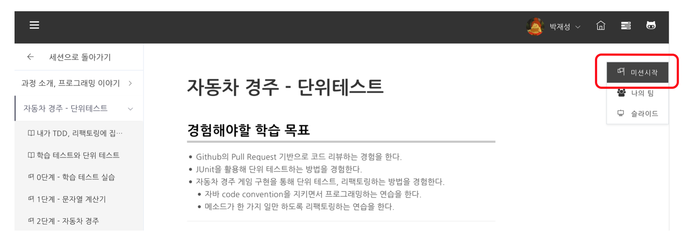
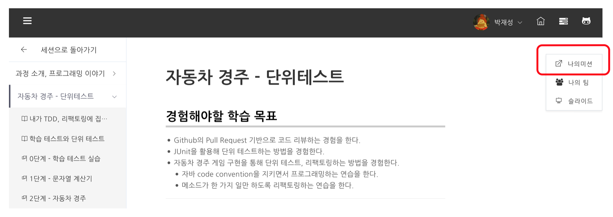
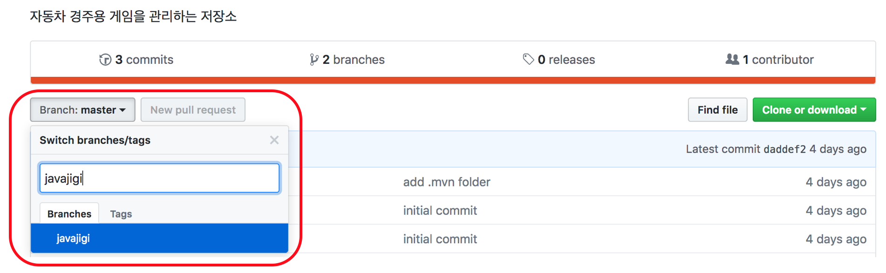
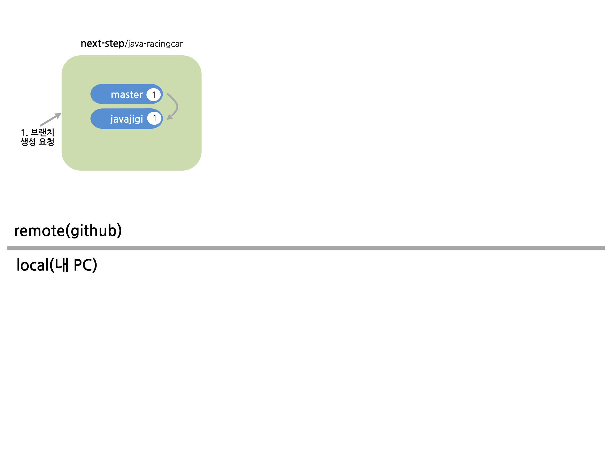

## gh(GitHub CLI) 터미널 환경 세팅
- 윈도우즈 운영체제 사용자
  - [GitHub CLI 공식 사이트](https://cli.github.com/)에서 설치 파일(.msi)을 내려받아 설치한다.
  - 또는 터미널(PowerShell)에서 `winget install --id GitHub.cli` 명령으로 설치한다.
  - 설치 후 터미널(Git Bash 등)을 새로 열고 `gh --version` 명령을 실행해 버전 정보가 출력되는지 확인한다.
- 맥 운영체제 사용자
  - 터미널을 실행한 후 `gh --version` 명령을 실행한다.
  - `command not found: gh` 메시지가 나오면 gh가 설치되어 있지 않은 것이므로 `brew install gh` 명령으로 설치한다.
  - Homebrew가 설치되어 있지 않다면 [Homebrew 공식 사이트](https://brew.sh/)를 참고해 먼저 설치한다.
- 공통: GitHub 계정 연결
  - 설치를 확인한 후 `gh auth login` 명령을 실행하고 안내에 따라 GitHub 계정으로 로그인한다.
  - `gh auth status` 명령으로 로그인 상태를 확인할 수 있다.
  - [GitHub CLI 설치 문서](https://github.com/cli/cli#installation) 참고

---
## 넥스트스텝 플랫폼에서 미션을 시작한다.
- NextStep(https://edu.nextstep.camp) 에 접속해 진행하려는 미션으로 이동한다. **미션 시작*- 버튼을 클릭한다.

- 미션을 시작하는 순간 미션 저장소에 자신의 github id 계정에 해당하는 브랜치가 생성되고 리뷰어가 배정된다.
- **나의 미션*- 버튼을 클릭해 미션을 진행할 수 있는 저장소로 이동한다.

- 자신의 github 계정 브랜치가 생성되어 있으면 다음과 같이 검색이 되어야 한다.

- 브랜치를 생성한 후 상태는 다음과 같다.

---
## 넥스트스텝 SKILL 활용해 미션 진행 및 리뷰 요청
- [넥스트스텝 SKILL](https://github.com/next-step/nextstep-skills) 저장소의 SKILL 활용해 미션 진행한다. 
